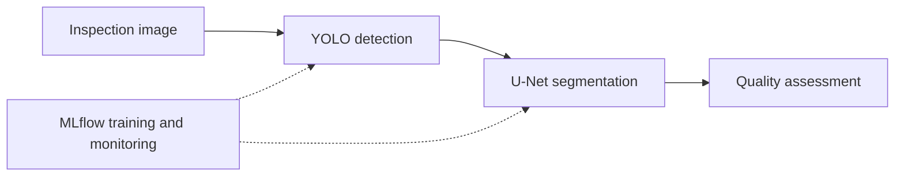
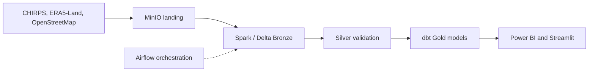
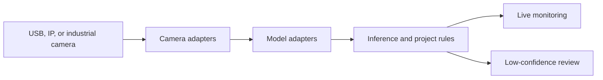
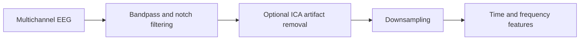
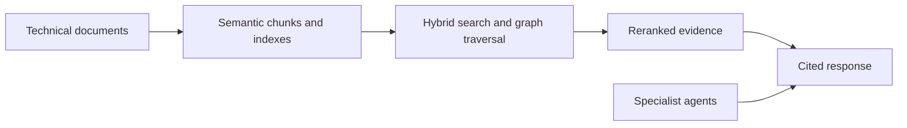
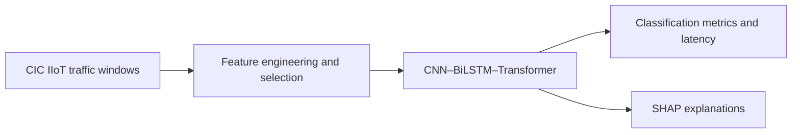
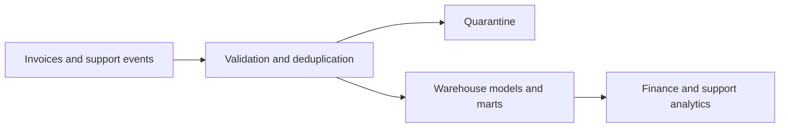

# Portfolio architecture diagrams

The flows summarize the documented systems. Open the case studies for technical details and links to each project.

## Automated visual inspection

## Morocco Climate & Water Observatory

## Vision Studio

## Stress Peak Detection from EEG

## Agents for Agriculture

## Explainable IoT Intrusion Detection

## Finance ETL on Google Cloud

